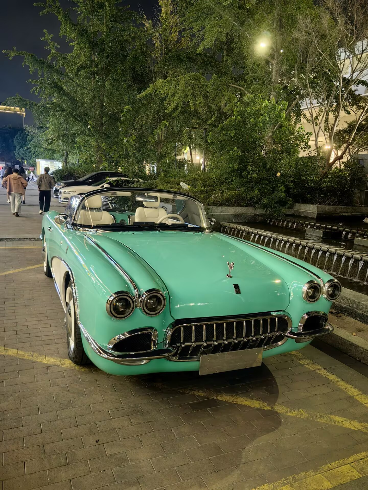
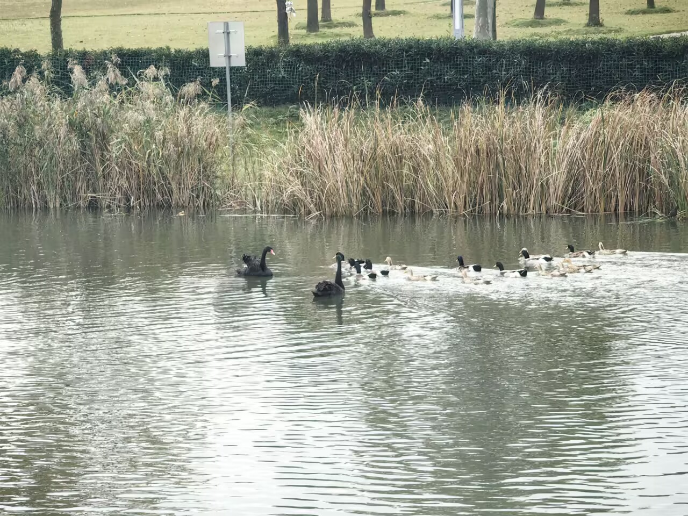
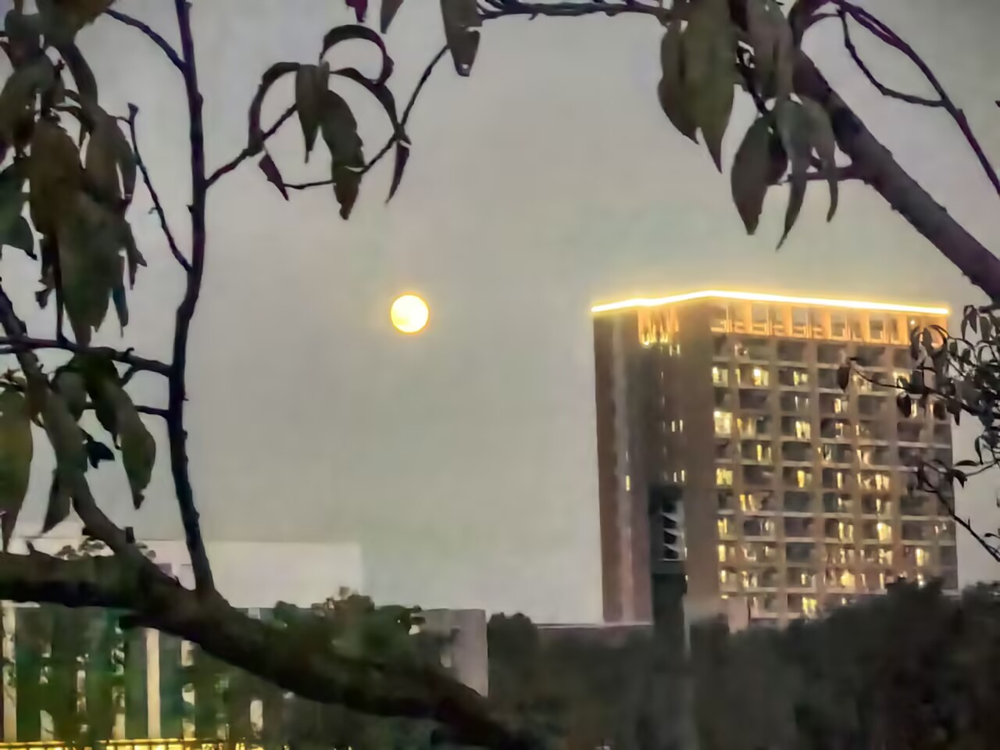
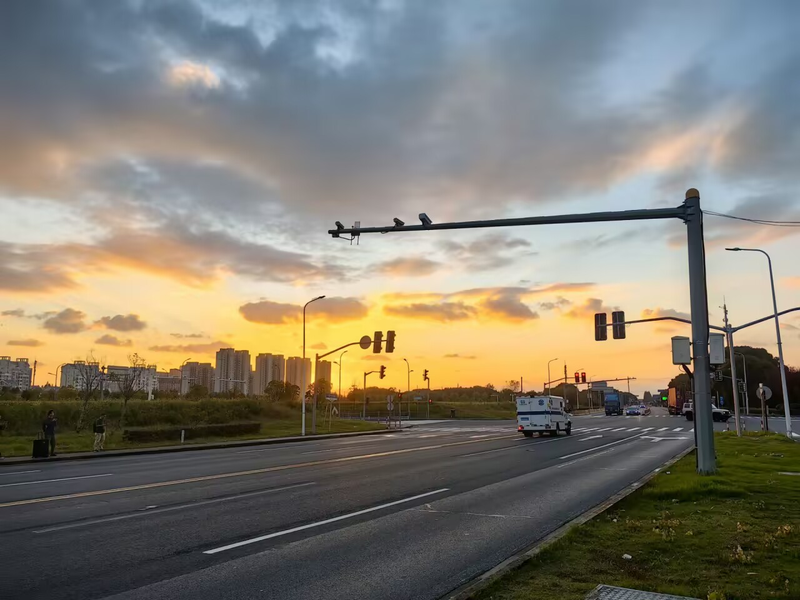
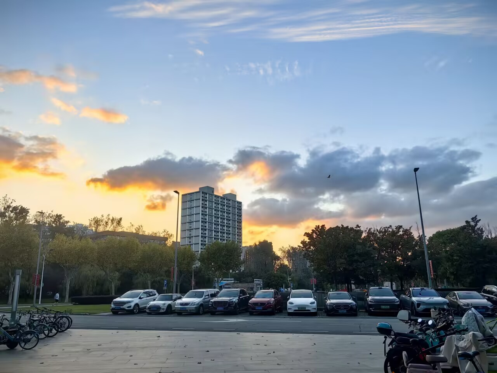
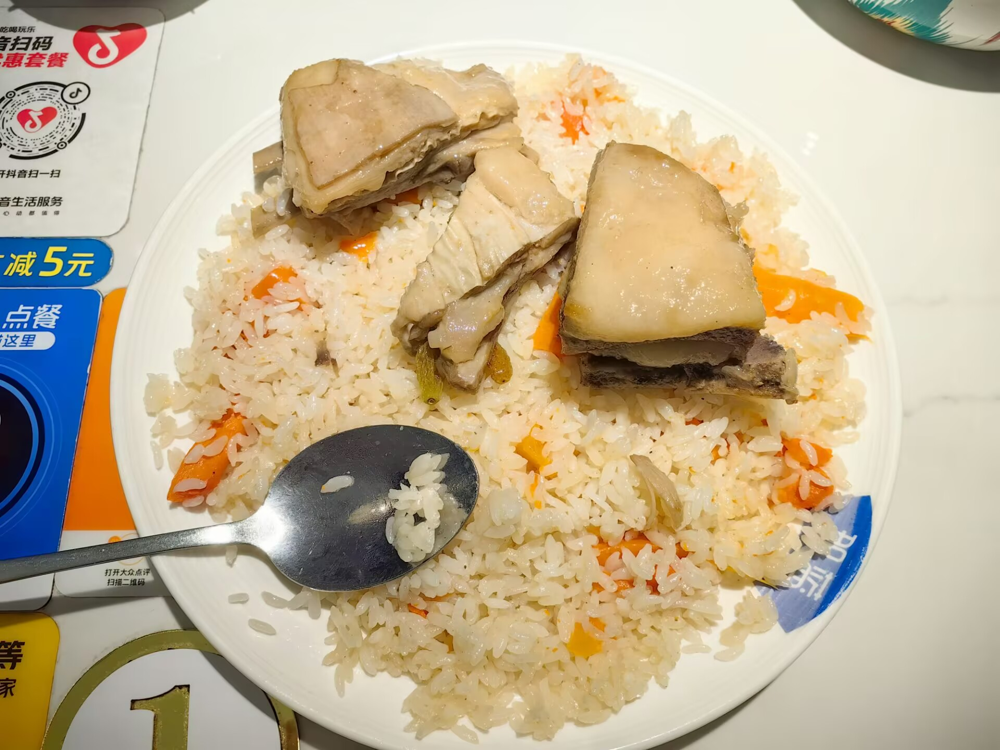

# Moments image scratchpad

Paste images in this Markdown file with `Ctrl+V`. VS Code stores each image in
`assets/images/moments/` and inserts a Markdown image link. Copy that link into
the `content` field of `_data/moments.yml`, leaving a blank line between the
text and the first image. Keep consecutive image links together for the gallery,
then remove them from this scratchpad.

